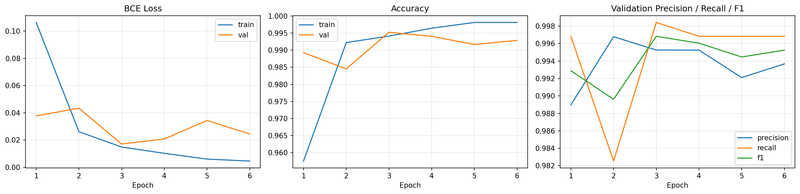

# Brain Tumor MRI Classifier

[](https://colab.research.google.com/github/ariansarathy/Brain-Tumor/blob/main/Brain_Tumor_Classifier.ipynb)

A binary image classifier that looks at a brain MRI scan and predicts whether it shows a tumor. It uses transfer learning on a pretrained ResNet-50 in PyTorch, and it is scored on a separate test set that the model never sees during training.

## Results

All scores are on the unseen test set.

| Metric | Default cutoff (0.5) | Tuned cutoff |
|---|---|---|
| Accuracy | | |
| Precision | | |
| Recall | | |
| F1 score | | |
| Missed tumors | | |
| False alarms | | |



## How it works

1. **Data.** About 7,000 brain MRI slices in four folders: glioma, meningioma, pituitary and no tumor. The three tumor types are grouped into one Tumor label, which makes this a yes or no problem. The dataset comes with its own Training and Testing split, and 15% of the training images are held back for validation.
2. **Preprocessing.** Every image is converted to grayscale, resized to 224 x 224 and normalized with ImageNet statistics. Training images are also randomly flipped, rotated up to 15 degrees and given small brightness and contrast changes, so the model learns the anatomy instead of memorizing individual scans.
3. **Model.** ResNet-50 with ImageNet weights. The early layers stay frozen, the last two stages are fine tuned at a low learning rate, and the original 1,000 class output is replaced with a single output and a sigmoid, giving the probability that a scan shows a tumor.
4. **Training.** Binary cross entropy loss with the AdamW optimizer. The learning rate drops when validation loss stalls, and early stopping ends training once validation loss stops improving, keeping the best checkpoint.
5. **Cutoff tuning.** A missed tumor costs far more than a false alarm, so after training the cutoff for calling a scan Tumor is lowered until the model catches at least 99% of tumors in the validation set. The test set plays no part in this choice, so the test scores stay honest.
6. **Evaluation.** Accuracy, precision, recall, F1 score and a confusion matrix on the test set, plus a count of missed tumors by tumor type.

## Run it

**In Google Colab (no setup needed)**

1. Click the **Open In Colab** badge above.
2. Go to **Runtime > Change runtime type** and choose a **T4 GPU**.
3. Go to **Runtime > Run all**. The notebook downloads the dataset, trains the model and prints the results. Training takes about 15 to 30 minutes on a free GPU.
4. Use the last section of the notebook to upload your own MRI image and get a prediction.

**On your own machine**

```bash
pip install torch torchvision scikit-learn matplotlib kagglehub
python brain_tumor_classifier.py
```

Download the dataset first and set `train_dir` and `test_dir` in the `Config` class to its `Training` and `Testing` folders. A GPU is strongly recommended.

## Repository contents

| File | Description |
|---|---|
| `Brain_Tumor_Classifier.ipynb` | Colab notebook with the full pipeline and saved results |
| `brain_tumor_classifier.py` | The same pipeline as a standalone Python script |
| `training_curves.png` | Loss, accuracy, precision, recall and F1 score by epoch |

## Limitations

- This is a learning project, not a medical device. It must not be used to diagnose anyone.
- The dataset combines several public MRI collections, and scans from the same source tend to look alike. Accuracy on scans from a new hospital or scanner would likely be lower.
- The model sees one 2D slice at a time. Real diagnosis uses the full 3D scan along with clinical context.

## Dataset

[Brain Tumor MRI Dataset](https://www.kaggle.com/datasets/masoudnickparvar/brain-tumor-mri-dataset) by Masoud Nickparvar on Kaggle. The images belong to their original sources and are not included in this repository.
